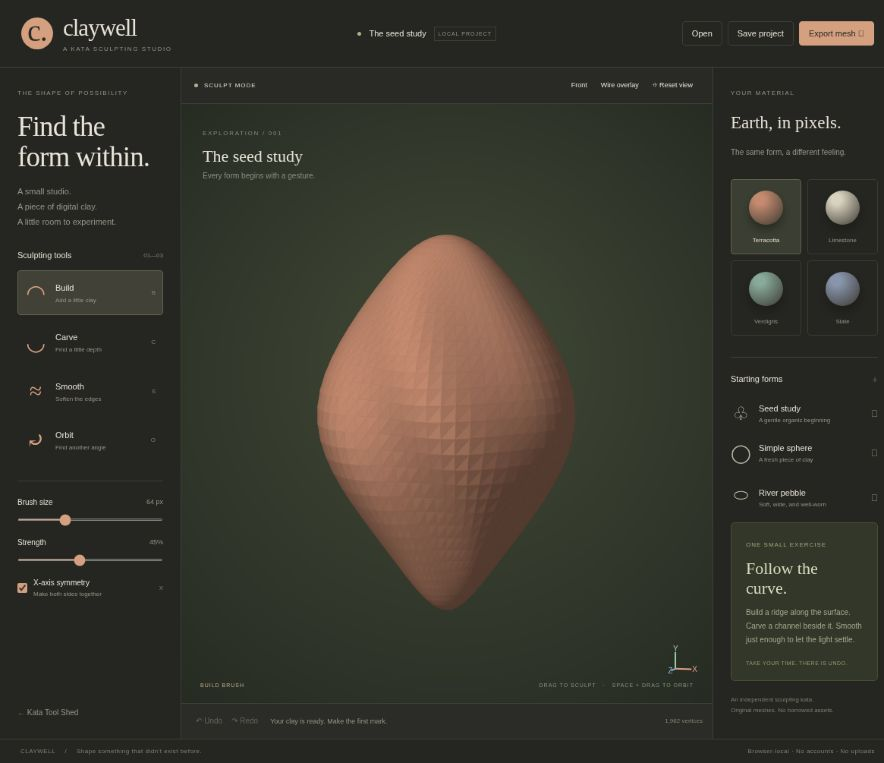
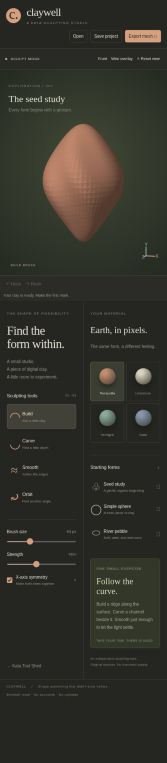

# Kata Claywell

**Find the form within.** A local-first sculpting studio inspired by ZBrush's brush-driven approach to digital clay. Original code, starter meshes, and earthy visual identity.

Part of [Kata Tool Shed](https://intrepion.github.io/tools/). Repository: `kata-app-inspired-by-zbrush-codex-dot`.

## Screenshots

Actual browser captures of the running localhost app, not mockups.



<details><summary>390px narrow-screen layout</summary>



</details>

## Run locally

Node.js 18 or newer. There are no package dependencies to install.

```sh
npm run dev
```

Open `http://127.0.0.1:4312` or the printed server URL. Do not open `index.html` with `file://`. Use `PORT=4316 npm run dev` for another port; in PowerShell use `$env:PORT=4316; npm run dev`.

```sh
npm run check
npm run build
```

`check` runs syntax checks and 13 Node tests. `build` creates a standalone static `dist/`. Serve that directory through HTTP. The development server also offers `/tests/browser.html` for browser-native UI tests and `/tests/responsive.html` for a 390px iframe layout check. These are excluded from production builds. `?test=1` disables autosave reads/writes for isolated checks.

## Sculpt something

1. Begin with the original **Seed study**, or choose **Simple sphere** or **River pebble**.
2. Use **Build** to displace vertices along their surface normals, **Carve** to move them inward, or **Smooth** to soften neighboring vertices.
3. Adjust brush diameter and strength. X-axis symmetry mirrors the brush center across the model's X axis.
4. Drag on the mesh to sculpt. Select **Orbit**, hold Space, or right-drag to rotate. Scroll to zoom. Use Front and Reset view to reorient.
5. Switch between Terracotta, Limestone, Verdigris and Slate, or enable a wire overlay to inspect the actual topology.
6. Save an editable `.claywell` project or export the mesh as a geometry-only Wavefront `.obj` file.

## Keyboard and accessibility

- B / C / S / O: Build / Carve / Smooth / Orbit.
- X: toggle X-axis symmetry.
- Ctrl/⌘ Z / Ctrl/⌘ Shift Z: undo / redo.
- Ctrl/⌘ S: download project.
- Focus the canvas, use arrow keys to move a keyboard brush cursor, and Enter to stamp. Shift + arrows moves farther. Space + drag or Orbit mode rotates the view. Alt temporarily uses Carve while sculpting.
- Controls have labels and focus indicators; selected buttons expose pressed states. Errors and save status are announced in a live region. The canvas remains a visual workflow, not a fully nonvisual sculpting interface.
- Narrow layouts put the canvas first and keep all controls in two panels below it.

## Real capabilities and deliberate limits

This is a **functional small mesh sculptor**, not ZBrush parity. Strokes deform actual mesh vertices with smooth radial falloff. The mesh has **1,962 vertices and 3,920 triangles**, fixed topology, and 20 document-level undo snapshots. Smoothing uses each vertex's immediate mesh neighbors. The renderer projects triangles onto Canvas 2D with simple directional lighting.

It does not implement dynamic topology, subdivision, retopology, DynaMesh, masks, subtools, polypaint, UVs, texture baking, custom alphas, poseable/radial symmetry, arbitrary mesh import, animation, pressure sensitivity, ZBrush formats, or photorealistic rendering. Dense detail is limited by the mesh resolution. Aggressive repeated strokes can fold or self-intersect the surface; geometry is clamped to a bounded range. The triangle painter may show artifacts in self-intersecting geometry. OBJ export contains positions and faces, not the material color. All views are orthographic.

## Persistence and privacy

No backend, account, telemetry, uploads, or remote assets. The latest sculpt autosaves to this origin's local storage; failures are reported. Storage is best-effort and can disappear with browser cleanup, private mode, or a new origin. **Download projects for durable backups.** In-memory undo history is not persisted.

Loading another project or starting a new form asks before replacing edits not yet downloaded, and replacement remains undoable. Imports validate format/version, exact topology vertex count, color and bounded finite coordinates. Files are limited to 1 MB. Incoming names render as text.

## Structure

- `src/core.js`: original mesh primitives, vector math, projected renderer, picking, history and OBJ serialization.
- `src/model.js`: starter forms, vertex deformation, adjacency and validation.
- `src/app.js`: sculpt input, keyboard controls, UI, project files and autosave.
- `tests/`: Node tests and browser UI/layout harnesses.
- `docs/INSPIRATION.md`: official-source research and scope decisions.
- `docs/QA.md`: actual checks and verification limits.
- `app.json`: Tool Shed metadata and published app link.

## License and attribution

MIT, see [LICENSE](LICENSE). Inspired by [Maxon ZBrush](https://www.maxon.net/en/zbrush), without affiliation, endorsement, copied branding, borrowed assets, or native file compatibility. The combined `.gitignore` covers Windows, macOS, Linux/Unix, editors, builds, dependencies, secrets and test outputs.


## Published app

Open [Kata Claywell](https://intrepion.github.io/kata-app-inspired-by-zbrush-codex-dot/). The public repository uses GitHub Actions to verify and deploy `dist/` from `main`. See [QA notes](docs/QA.md) for local verification and known limits.
